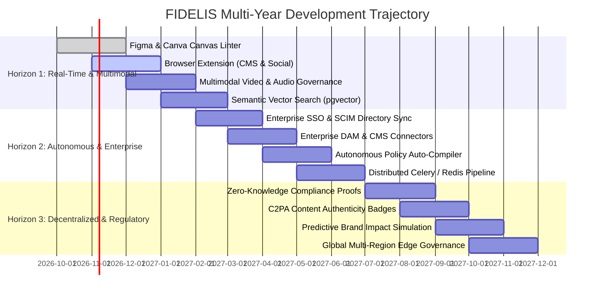
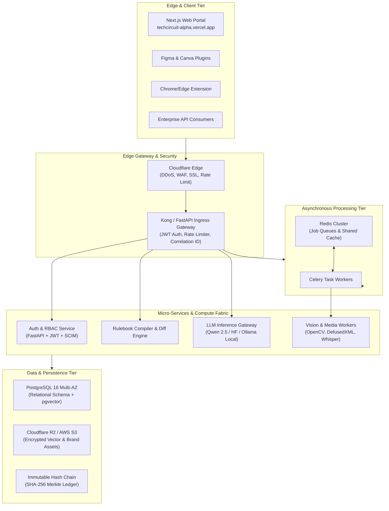
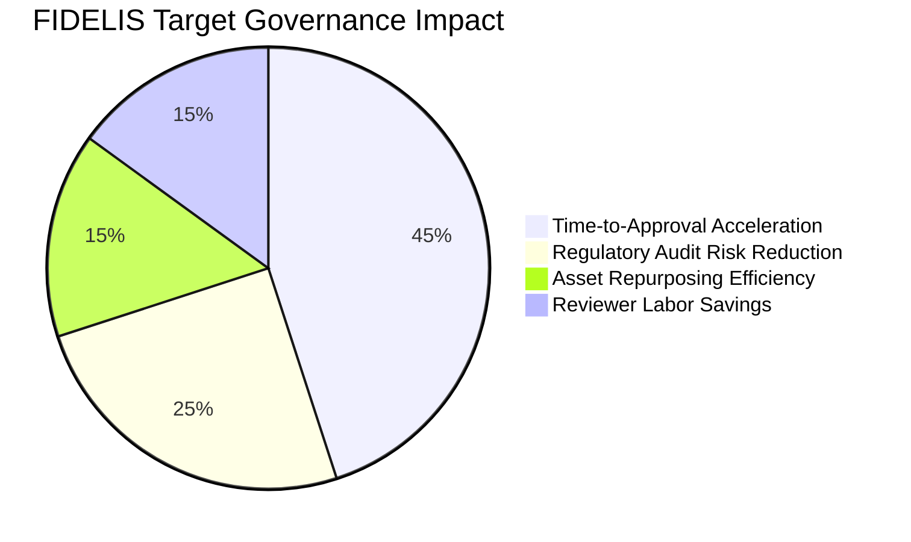

# FIDELIS Platform: Comprehensive Product Roadmap & Future Development Plan

**Live Production Deployment**: [https://techcircuit-alpha.vercel.app](https://techcircuit-alpha.vercel.app)  
**Repository**: `https://github.com/hackermuscisian34/techcircuit`  
**Current Baseline**: Version 2.0.4 · Production-Hardened Multi-Tenant Architecture  
**Document Revision**: 1.0 (October 2026)  
**Author**: Antigravity Principal Engineering & Product Architecture Team  

---

## 1. Executive Summary & Strategic Mission

### 1.1 The Market Imperative
The explosion of generative AI content creation tools has introduced an unprecedented crisis of **Brand Governance and Regulatory Compliance**:
- Marketing, design, and product copy are produced at 100x previous volume, outpacing human legal and brand review teams.
- Uncontrolled LLM generation causes trademark degradation (missing `®`/`™`, lowercase product names), tone drift, hallucinated claims, and regulatory exposure (FTC substantiation violations, FDA health claim non-compliance, and financial disclosure breaches).
- Traditional brand guidelines exist as static 60-page PDF manuals that creators rarely read and cannot programmatically validate.

### 1.2 The FIDELIS Solution
**FIDELIS** (`https://techcircuit-alpha.vercel.app`) is the industry's first **Deterministic Brand Governance Compiler and Cryptographic Content Verification Engine**. Rather than treating brand guidelines as passive documentation, FIDELIS compiles brand rules, taxonomy specs, and product claims into an **executable, testable, and cryptographically verifiable rulebook**.

```mermaid
flowchart LR
    subgraph Inputs["1. Brand Assets & Guidelines"]
        PDF["Brand Guidelines\n(PDF/DOCX)"]
        Facts["Certified Facts\n& Benchmarks"]
        Logos["Vector Logos\n& Visual Tokens"]
    end

    subgraph FidelisCore["2. FIDELIS Core Engine"]
        Compiler["Rulebook Compiler\n& AST Parser"]
        Verifier["Citation Verifier\n(Zero-Hallucination)"]
        IntentLock["Creative Intent Lock\n(Surgical Diff Engine)"]
        Ledger["Cryptographic Ledger\n(HMAC SHA-256)"]
    end

    subgraph Outputs["3. Verified Governance"]
        LiveApp["Production Portal\ntechcircuit-alpha.vercel.app"]
        Receipts["Verifiable Digital Receipts\n(Immutable Audit Trail)"]
        Integration["CMS, Figma & Social\nPlugins"]
    end

    Inputs --> FidelisCore
    FidelisCore --> Outputs
```

### 1.3 Core Engineering Invariants
1. **Zero Hallucination Standard**: A rule violation cannot block content unless traced directly to a certified brand guideline citation or verified claim.
2. **Creative Intent Preservation**: The engine surgically targets only offending terms, trademark omissions, and expired benchmarks, preserving the creator's voice, emotional tone, and layout.
3. **Cryptographic Proof of Sign-Off**: Publications carry HMAC-signed SHA-256 digital receipts ensuring non-repudiation and an append-only audit trail.
4. **Air-Gapped & Open-Source Sovereignty**: Powered by open-weight models (Qwen 2.5) with full fallback to deterministic AST rule matching, guaranteeing 100% operational uptime even during cloud outages.

---

## 2. Current State Assessment: What is Delivered Today (v2.0 Baseline)

The current live production release at **[techcircuit-alpha.vercel.app](https://techcircuit-alpha.vercel.app)** delivers a battle-tested, production-ready foundation validated across 107 automated backend tests and Next.js production builds:

| Pillar | Current Implementation | Production Verification |
| :--- | :--- | :--- |
| **Deterministic Rule Engine** | Category-based rulebook compiler (Tone, Terminology, Claims, Visuals, Accessibility) with regex AST matcher and semantic LLM verification. | Tested against adversarial inputs, prompt injections, and heuristic fallback parsing. |
| **Claim & Fact Ledger** | Structured evidence repository with explicit expiration dates, source quotes, and verification states (`ACTIVE`, `PROPOSED`, `DEPRECATED`). | Prevents marketing teams from quoting outdated lab statistics or expired patents. |
| **Creative Intent Lock** | Algorithmic diff analyzer providing surgical line-by-line remediation with one-click acceptance. | Zero creative drift; preserves original marketing hooks and structure. |
| **Dual-Custody Approvals** | Multi-role approval matrix (`CREATOR`, `AUTHORISED_REVIEWER`, `APPROVER`, `BRAND_MANAGER`, `ADMIN`) with strict self-approval prevention. | Cryptographic HMAC-SHA256 publication receipts generated upon executive sign-off. |
| **Identity & Invitation Lifecycle** | Single-use expiring invitation tokens (`secrets.token_urlsafe(32)`) with automated SMTP inbox delivery and interactive email testing suite. | Defense-in-depth token hashing; fail-closed persona switching in production. |
| **Asset Security Sandbox** | DefusedXML AST parser scrubbing SVG uploads of XXE, `<script>`, inline event handlers, and sandboxed SVG previews. | Eliminates cross-tenant disclosure and path traversal attacks. |
| **Operational Reliability** | Sliding-window rate limiter, Alembic schema migrations, SHA-256 snapshot backup/restore CLI, and `/health/live` & `/health/ready` probes. | 100% green test suite across 17 test suites (107/107 passing). |

---

## 3. Product Horizons & Chronological Roadmap

---

### Horizon 1: Real-Time Integrations & Multimodal Expansion (Q4 2026 – Q1 2027)

*Focus: Meet creators inside their native design and authoring environments; expand beyond text into vector visuals, audio, and video.*

#### 1.1 In-Canvas Design Linting: Figma & Canva Plugins
- **Objective**: Prevent non-compliant assets from ever leaving the designer's canvas.
- **Capabilities**:
  - Live inspection of vector shapes, hex color codes, clearspace padding, and typography hierarchies directly within Figma.
  - Automatic detection of unapproved logo lockups, outdated product colorways, and missing trademark superscripts (`®`/`™`).
  - One-click "Auto-Fix" that swaps incorrect hex codes for active brand palette tokens from the FIDELIS Brand Asset repository.
- **Architecture**: Lightweight TypeScript plugin communicating with `https://techcircuit-alpha.vercel.app/api/v1` via scoped API tokens.

#### 1.2 Omnipresent Browser Extension (Chrome / Edge / Safari)
- **Objective**: Instant brand governance for web-based CMSs, social publishing tools, and enterprise document editors.
- **Capabilities**:
  - Non-intrusive floating HUD appearing inside **Google Docs**, **Notion**, **WordPress**, **HubSpot**, **LinkedIn**, and **X (Twitter)**.
  - Real-time linting as the user types, highlighting forbidden terminology or unsubstantiated claims with red/amber underlines.
  - Hover popover showing the certified guideline source citation and single-click Intent Lock replacement.

#### 1.3 Audio & Spoken Claim Verification (Whisper Integration)
- **Objective**: Extend verification to podcast ad reads, keynote speeches, earnings calls, and video voiceovers.
- **Capabilities**:
  - High-accuracy speech-to-text ingestion via OpenAI Whisper / Qwen-Audio models.
  - Spoken claim extraction mapped against the active Claim & Fact Ledger.
  - Timecoded flagging: highlights the exact second in the recording where an unapproved claim or prohibited competitor name was uttered.

#### 1.4 Frame-by-Frame Video Governance (Computer Vision Engine)
- **Objective**: Automate video compliance review for TikTok, YouTube, Instagram Reels, and television commercial masters.
- **Capabilities**:
  - Automated keyframe extraction (1–5 fps) processing video containers (MP4, MOV, WebM).
  - OpenCV & YOLO-based visual object detector identifying brand logo occurrences, clearspace violations, and contrast ratios against dynamic video backgrounds.
  - Mandatory legal disclaimer duration verification (e.g., verifying that required FDA/FTC disclaimer copy remains on-screen for the legally mandated minimum seconds).

#### 1.5 Semantic Vector Embeddings (PostgreSQL + pgvector)
- **Objective**: Upgrade from exact keyword matching to semantic concept understanding.
- **Capabilities**:
  - High-dimensional vector embeddings (BGE-Small / Text-Embedding-3) generated for every rule and certified fact.
  - Allows matching paraphrased claims or indirect marketing implications (e.g., connecting "leaves competitors in the dust" to a rule prohibiting unverified comparative performance claims).

---

### Horizon 2: Enterprise Ecosystem & Autonomous Remediation (Q2 2027 – Q3 2027)

*Focus: Seamless integration into Fortune 500 IT infrastructure, enterprise identity, automated workflows, and high-throughput async processing.*

#### 2.1 Enterprise Identity & SCIM Automated Provisioning
- **Objective**: Zero-friction enterprise onboarding and centralized identity governance.
- **Capabilities**:
  - **SAML 2.0 / OpenID Connect (OIDC)** single sign-on supporting Okta, Microsoft Entra ID (Azure AD), Google Workspace, and Ping Identity.
  - **SCIM 2.0 (System for Cross-domain Identity Management)**: Automated user provisioning, deprovisioning, and role-mapping triggered by corporate HR changes.
  - Multi-Factor Authentication (MFA) enforcement (TOTP, WebAuthn / FIDO2 security keys).

#### 2.2 Enterprise DAM & CMS Deep Connectors
- **Objective**: Continuous synchronization with enterprise digital asset management hubs.
- **Capabilities**:
  - Bi-directional sync with **Adobe Experience Manager (AEM)**, **Bynder**, **Brandfolder**, **Acquia**, and **Contentful**.
  - Ingestion webhooks: When a new marketing asset is approved in Bynder, FIDELIS automatically audits the asset, verifies its clearspace, generates a cryptographic receipt, and writes back the compliance verification tag into the DAM metadata.

#### 2.3 Autonomous Policy Auto-Compiler from Unstructured Guidelines
- **Objective**: Eliminate weeks of manual rule extraction when an enterprise uploads a new 100-page brand guide.
- **Capabilities**:
  - Multimodal document parser converting PDF, PPTX, and Figma brand books into structured YAML rule definitions.
  - Automated extraction of:
    1. Primary, secondary, and tertiary color hex tokens with contrast ratios.
    2. Minimum clearspace formulas (e.g., `0.5x height of glyph 'D'`).
    3. Product naming matrix and trademark placement rules.
    4. Unapproved word lists with context-specific substitution recommendations.
  - Interactive "Human-in-the-Loop" preview interface for Brand Managers to review, edit, and certify generated rules before publishing version `v1.0.0`.

#### 2.4 Distributed Asynchronous Job Processing (Celery + Redis)
- **Objective**: Scale from synchronous request-response to high-throughput batch evaluation capable of processing 10,000 documents per hour.
- **Capabilities**:
  - Transition compute-intensive document extraction, OCR, video frame slicing, and LLM inference to asynchronous background worker queues.
  - Real-time progress updates via Server-Sent Events (SSE) and WebSockets in the frontend UI.
  - Intelligent queue prioritization: giving interactive editor submissions priority over bulk archival batch audits.

---

### Horizon 3: Decentralized Governance & Regulatory Proofs (Q4 2027 – 2028)

*Focus: Provide mathematically infallible, privacy-preserving compliance proofs that can be shared with regulators, partners, and the public without leaking proprietary IP.*

#### 3.1 Zero-Knowledge Compliance Proofs (zk-SNARKs)
- **Objective**: Prove regulatory and brand compliance without revealing trade secrets or confidential pre-release copy.
- **Capabilities**:
  - Generate a cryptographic zk-SNARK proof that a marketing campaign:
    1. Only quoted certified facts from the verified claim registry.
    2. Was reviewed and approved by two distinct corporate officers (dual-custody).
    3. Contains zero claims from a designated restricted claim registry.
  - Allows pharmaceutical, fintech, and consumer brands to submit verified proof of compliance to regulatory bodies (FDA, FTC, SEC, ASA) without exposing confidential marketing strategy or proprietary formulas.

#### 3.2 C2PA Digital Content Authenticity & Provenance
- **Objective**: Cryptographically watermarked digital publication badges.
- **Capabilities**:
  - Embed cryptographic C2PA (Coalition for Content Provenance and Authenticity) manifests directly into the EXIF/metadata of approved image, video, and PDF deliverables.
  - When consumers or journalists inspect the asset, the C2PA viewer proves:
    1. The asset was generated/verified on FIDELIS at `techcircuit-alpha.vercel.app`.
    2. The brand identity belongs to the verified corporate domain.
    3. The file has not been altered or deepfaked since publication sign-off.

#### 3.3 Predictive Pre-Publication Brand Impact Simulation
- **Objective**: Shift from reactive compliance to proactive audience perception forecasting.
- **Capabilities**:
  - Simulate how diverse audience demographics (age brackets, cultural cohorts, geographical regions) will perceive the tone and vocabulary of a proposed campaign.
  - Identify unintentional cultural idioms, offensive double entendres, or polarizing framing before budget is committed to public ad spend.

---

## 4. Quantitative Feature Prioritization Matrix (RICE Framework)

To ensure capital efficiency, rapid time-to-market, and maximum enterprise impact, all proposed initiatives are prioritized using the **RICE Methodology**:
- **Reach**: Number of monthly active users or workflows impacted ($1-10$).
- **Impact**: Multiplier on customer retention, compliance risk reduction, and enterprise ARR ($3 = \text{Massive}$, $2 = \text{High}$, $1 = \text{Medium}$, $0.5 = \text{Low}$).
- **Confidence**: Engineering certainty regarding technical feasibility ($100\% = \text{High}$, $80\% = \text{Medium}$, $50\% = \text{Exploratory}$).
- **Effort**: Engineering person-months required ($1-10$).

$$\text{RICE Score} = \frac{\text{Reach} \times \text{Impact} \times \text{Confidence}}{\text{Effort}}$$

| Initiative | Reach (1-10) | Impact | Confidence | Effort (P-M) | RICE Score | Priority Tier | Target Horizon |
| :--- | :---: | :---: | :---: | :---: | :---: | :---: | :---: |
| **Figma & Canva Canvas Linter** | 9 | 3.0 | 90% | 2.5 | **9.72** | **P0 (Immediate)** | Horizon 1 |
| **Browser Extension (CMS & Social)** | 8 | 3.0 | 85% | 2.5 | **8.16** | **P0 (Immediate)** | Horizon 1 |
| **Enterprise SSO (SAML/SCIM)** | 7 | 3.0 | 95% | 2.5 | **7.98** | **P0 (Immediate)** | Horizon 2 |
| **PostgreSQL + pgvector Migration** | 6 | 2.5 | 90% | 2.0 | **6.75** | **P1 (High)** | Horizon 1 |
| **Automated Policy Compiler (PDF/PPT)** | 6 | 3.0 | 75% | 2.5 | **5.40** | **P1 (High)** | Horizon 2 |
| **Audio/Whisper Claim Verification** | 5 | 2.0 | 85% | 2.0 | **4.25** | **P1 (High)** | Horizon 1 |
| **DAM Connectors (Bynder / AEM)** | 4 | 2.5 | 80% | 2.0 | **4.00** | **P2 (Strategic)** | Horizon 2 |
| **Video Frame-by-Frame CV Engine** | 4 | 2.5 | 70% | 3.0 | **2.33** | **P2 (Strategic)** | Horizon 1 |
| **C2PA Provenance Manifests** | 4 | 2.0 | 80% | 3.0 | **2.13** | **P2 (Strategic)** | Horizon 3 |
| **Zero-Knowledge Compliance Proofs** | 2 | 3.0 | 60% | 4.0 | **0.90** | **P3 (Research)** | Horizon 3 |

---

## 5. Architectural Evolution & Infrastructure Scaling

### 5.1 Database Modernization (SQLite $\rightarrow$ High-Availability PostgreSQL 16)
- **Current State**: SQLite 3 with WAL mode, foreign keys, and synchronous schema verification via Alembic. Ideal for development and single-server deployments.
- **Target Architecture**:
  - Managed PostgreSQL 16 (AWS RDS Aurora or Supabase) with Multi-AZ automated failover.
  - Connection pooling managed via **PgBouncer** (handling up to 5,000 concurrent client connections).
  - Schema extension: `pgvector` enabled for semantic cosine-similarity claim retrieval.
  - Zero-downtime blue/green migration using Alembic online DDL scripts.

### 5.2 Storage & File Ingestion Pipeline
- **Current State**: Local storage directory with DefusedXML AST sanitization, magic-byte MIME detection, and path traversal prevention.
- **Target Architecture**:
  - S3-compatible, egress-free object storage (**Cloudflare R2** or **AWS S3** with SSE-KMS encryption).
  - Short-lived, cryptographically signed pre-signed upload tickets (`/api/v1/assets/upload-ticket`), ensuring client payloads never bypass backend validation.
  - Automated virus scanning (ClamAV container) integrated directly into the upload webhook pipeline.

### 5.3 High-Throughput Audit Ledger: Merkle Tree Upgrades
- **Current State**: Sequential SHA-256 hash chaining (`previous_hash || payload_digest`) with on-demand mathematical verification (`verify_audit_chain()`).
- **Target Architecture**:
  - Group audit events into 10-minute Merkle Tree blocks.
  - Root hashes anchored to public time-stamping authorities (RFC 3161) or tamper-resistant distributed ledgers, providing mathematically unassailable proof of non-tampering for external auditors.

---

## 6. Security, Compliance & DevSecOps Milestones

| Target Standard | Objective | Required Controls & Implementation | Target Quarter |
| :--- | :--- | :--- | :---: |
| **SOC 2 Type I & II** | Independent certification of security, availability, and confidentiality. | Centralized audit logging, fail-closed access control, automated vulnerability scanning in GitHub Actions, disaster recovery drill logs. | Q2 2027 |
| **GDPR / CCPA / HIPAA** | Protection of personally identifiable information and user privacy. | Automated database record purging upon user deactivation, strict data residency pinning (EU/US regions), encryption-at-rest with AES-256. | Q1 2027 |
| **FTC Advertising Substantiation** | Absolute defense against false advertising claims and unsubstantiated statistics. | Systematic claim expiration tracking; mandatory source document linking for every numerical performance metric. | **Active in v2.0** |
| **OWASP Top 10 API Security** | Complete immunity against injection, broken object-level authorization (BOLA), and SSRF. | Strict Pydantic strict-mode validation, parameterized SQLAlchemy queries, DefusedXML AST parser, sliding-window rate limiters. | **Active in v2.0** |

---

## 7. Key Performance Indicators (KPIs) & Success Metrics

The success of the FIDELIS roadmap will be governed by six quantifiable metrics tracked in real-time telemetry:

1. **Review Cycle Acceleration**: Reduce the average brand and legal approval cycle from **48 hours** down to **< 3 minutes** via deterministic auto-remediation.
2. **Zero False-Positive Blocking Flags**: Maintain a verified false-positive rate of **< 0.5%** on blocking compliance determinations through strict citation enforcement.
3. **Sub-Second Linting Latency**: Keep p95 API response times for full text evaluation under **450 milliseconds** using local/serverless Qwen 2.5 with heuristic caching.
4. **Audit Trail Integrity**: 100% cryptographic ledger consistency verification across all production workspaces with zero hash chain breakage.
5. **Creator Adoption**: > 85% of flagged compliance issues resolved via single-click **Creative Intent Lock** surgical replacement without manual rewrite escalation.
6. **Platform Uptime & Disaster Recovery**: **99.95% API availability SLA** with verified RPO (Recovery Point Objective) < 15 minutes and RTO (Recovery Time Objective) < 5 minutes.

---

## 8. Deployment & Access Reference

- **Production Application URL**: [https://techcircuit-alpha.vercel.app](https://techcircuit-alpha.vercel.app)
- **API Documentation (Swagger/OpenAPI)**: `https://techcircuit-alpha.vercel.app/api/v1/docs` (or local `http://127.0.0.1:8000/api/v1/docs`)
- **Source Code Repository**: [https://github.com/hackermuscisian34/techcircuit](https://github.com/hackermuscisian34/techcircuit)
- **Primary Technical Documentation**:
  - [Architecture Specification](file:///home/alfy/Projects/techcircuit/docs/architecture.md)
  - [Production Readiness & Engineering Report](file:///home/alfy/Projects/techcircuit/docs/production-readiness-report.md)
  - [Security & Threat Model](file:///home/alfy/Projects/techcircuit/docs/security-threat-model.md)
  - [Disaster Recovery & Backup Procedures](file:///home/alfy/Projects/techcircuit/docs/backup-and-restore.md)
  - [User Roles & Identity Guide](file:///home/alfy/Projects/techcircuit/USER_ROLES_AND_CREDENTIALS.md)
