# FIDELIS Brand Governance Platform: User Roles & Testing Credentials

> **Single Source of Truth** for user authentication, test accounts, and Role-Based Access Control (RBAC) permissions across the FIDELIS Brand Governance Compiler.

---

## 1. Local Development & Testing Credentials

> [!WARNING]
> **LOCAL DEVELOPMENT & TESTING ONLY**: The demo accounts and shared passwords (`Password123!`) below are restricted strictly to local development and test environments (`ENVIRONMENT in ('development', 'dev', 'local', 'test')`).
> In production environments, demo user seeding is disabled (`ENABLE_DEMO_ACCOUNTS=false`) and the startup fails closed if unsafe demo configurations are detected.

| Full Name | Role Display Name | System Role Code | Login Username / Email | Password (Local Dev Only) | Primary Workspace |
| :--- | :--- | :--- | :--- | :--- | :--- |
| **Alfred Biju** | **System Administrator** | `ADMIN` | `alfred@apexdynamics.example`<br>*(or simply `alfred`)* | `Password123!` | ApexDynamics (`ws-apexdynamics-001`) |
| **Sebin Sabu** | **Brand Manager** | `BRAND_MANAGER` | `sebin@apexdynamics.example`<br>*(or simply `sebin`)* | `Password123!` | ApexDynamics (`ws-apexdynamics-001`) |
| **Albert Biju** | **Compliance Reviewer** | `AUTHORISED_REVIEWER` | `albert@apexdynamics.example`<br>*(or simply `albert`)* | `Password123!` | ApexDynamics (`ws-apexdynamics-001`) |
| **Adhithya Biju** | **Content Creator** | `CREATOR` | `adhithya@apexdynamics.example`<br>*(or simply `adhithya`)* | `Password123!` | ApexDynamics (`ws-apexdynamics-001`) |
| **Biju** | **Executive Approver** | `APPROVER` | `biju@apexdynamics.example`<br>*(or simply `biju`)* | `Password123!` | ApexDynamics (`ws-apexdynamics-001`) |

> [!TIP]
> **Flexible Login Input**: The login endpoint supports both full email addresses (e.g. `alfred@apexdynamics.example`) and short first-name usernames (e.g. `alfred`, `sebin`, `albert`, `adhithya`, `biju`).

---

### Production Initial Administrator Provisioning (Bootstrap)

In a fresh production deployment where no accounts exist:
1. Call `POST /api/v1/auth/bootstrap-admin` with payload:
   ```json
   {
     "email": "lead-admin@yourcompany.com",
     "password": "<STRONG_RANDOM_PASSWORD_MIN_12_CHARS>",
     "full_name": "Primary Platform Administrator"
   }
   ```
2. This one-time provisioning endpoint creates the initial `ADMIN` user.
3. If any active administrator already exists in the system, this endpoint **fails closed** with `HTTP 403 Forbidden` to prevent account hijacking.

---

### Privileged Role Provisioning via Invitations

Public self-registration (`POST /api/v1/auth/register`) strictly creates standard `CREATOR` accounts.
Privileged roles (`ADMIN`, `BRAND_MANAGER`, `AUTHORISED_REVIEWER`, `APPROVER`) must be invited by an Administrator:
1. An Administrator creates an invitation via the Admin Portal (`/admin`) or `POST /api/v1/auth/invitations`:
   ```json
   {
     "email": "reviewer@yourcompany.com",
     "role": "AUTHORISED_REVIEWER",
     "expires_in_days": 7
   }
   ```
2. The system generates a cryptographically secure, single-use token (`secrets.token_urlsafe(32)`), stores only its SHA-256 digest in the database, and returns an invitation acceptance link.
3. The invitee visits the link or uses the "Accept Invite" tab on `/login` to set their password and activate their assigned role.
4. Tokens expire automatically after the configured duration and cannot be reused once accepted.

---

## 2. In-Depth Guide: What Each Role Can Do in FIDELIS

FIDELIS implements a strict, enterprise-grade Role-Based Access Control (RBAC) hierarchy. Below is an exhaustive breakdown of each role's responsibilities, accessible routes, authorized actions, and security constraints.

```mermaid
flowchart TD
    subgraph Execution["1. Content & Drafting"]
        Creator["Content Creator\n(Adhithya Biju)"]
        Creator -->|Drafts copy & tests diffs| ReviewStudio["/review · Review Studio"]
    end

    subgraph Inspection["2. Compliance & Verification"]
        Reviewer["Compliance Reviewer\n(Albert Biju)"]
        Reviewer -->|Audits citations & coordinates| Findings["/findings · Citation Verifier"]
        Reviewer -->|Inspects visual clearspace| Assets["/assets · Logo & Assets Studio"]
    end

    subgraph Governance["3. Brand Authority & Taxonomy"]
        Manager["Brand Manager\n(Sebin Sabu)"]
        Manager -->|Compiles rules & runs unit tests| Rulebook["/rulebook · Rulebook Studio"]
        Manager -->|Updates certified facts & expiries| FactVault["/facts · Claim Ledger"]
        Manager -->|Reviews override proposals| Insights["/insights · Governance Loop"]
    end

    subgraph Release["4. Formal Sign-Off & Receipts"]
        Approver["Executive Approver\n(Biju)"]
        Approver -->|Signs releases with HMAC-SHA256| Approvals["/approvals · Approval Queue"]
    end

    subgraph Oversight["5. System Administration"]
        Admin["System Administrator\n(Alfred Biju)"]
        Admin -->|Cryptographic verification & settings| Audit["/audit · Cryptographic Ledger"]
        Admin -->|Elevated overrides & security| Settings["/settings · Platform Admin"]
    end
```



---

### Role 1: System Administrator (`ADMIN`)
- **Assigned User**: **Alfred Biju**
- **Email**: `alfred@apexdynamics.example`
- **Password**: `Password123!`
- **Primary Route Access**: `/dashboard`, `/audit`, `/settings`, `/rulebook`, `/facts`, `/assets`, `/approvals`, `/review`, `/findings`, `/insights`

#### Core Responsibilities
The System Administrator possesses full supervisory authority over the entire FIDELIS platform, tenant isolation boundaries, system health, local AI inference models, and the cryptographic audit ledger.

#### What Alfred Biju Can Do:
1. **Cryptographic Ledger Integrity Verification**:
   - Access `/audit` to inspect the append-only SHA-256 hash chain linking every review, override, and approval.
   - Run cryptographic tamper-detection algorithms to verify that no log events or receipts have been altered.
2. **System Health & LLM Runtime Control**:
   - Access `/settings` to inspect LLM model availability (Hugging Face Cloud Qwen 2.5 API with regional endpoints / Ollama local `qwen2.5`), memory usage, and fallback mock heuristics.
3. **Emergency Override & Elevation**:
   - Can override and unblock content in emergency scenarios (logged as an explicit `ADMIN_OVERRIDE` audit block).
   - Can invite and provision privileged roles (Brand Manager, Approver, Reviewer).
4. **Tenant & Workspace Management**:
   - Manage workspaces and tenant slug isolation.

#### Security Restrictions:
- Administrator accounts **cannot be created via public self-registration**. They can only be provisioned directly by existing administrators or initialized via database seeds.

---

### Role 2: Brand Manager (`BRAND_MANAGER`)
- **Assigned User**: **Sebin Sabu**
- **Email**: `sebin@apexdynamics.example`
- **Password**: `Password123!`
- **Primary Route Access**: `/rulebook`, `/facts`, `/insights`, `/assets`, `/dashboard`, `/review`

#### Core Responsibilities
The Brand Manager is the guardian of the corporate identity, trademark taxonomy, and certified factual claims. They curate the compiled rulebook, maintain engineering facts, and evolve brand guidelines based on real-world usage.

#### What Sebin Sabu Can Do:
1. **Rulebook Studio & Compiler (`/rulebook`)**:
   - Upload new brand guideline PDFs and trigger the AI Rulebook Compiler to extract atomic rules (naming, typography, clearspace, trademarks).
   - Add, edit, activate, and deprecate brand rules.
   - Run **Unit Test Suites** against rules with embedded Pass/Fail pairs to prevent false-positive regressions.
2. **Claim Ledger & Fact Vault (`/facts`)**:
   - Certify official engineering benchmarks, customer counts, and uptime SLAs.
   - Set validity horizons (`valid_from` to `valid_until`) to prevent stale statistics.
   - Upload proof documents (e.g. SOC 2 Type II PDFs, USPTO trademark certificates).
3. **Governance Loop & Amendment Proposals (`/insights`)**:
   - Review clustered reviewer overrides.
   - Accept or reject auto-drafted rule amendment proposals generated by the platform's self-evolving governance engine.
4. **Brand Asset Management (`/assets`)**:
   - Upload and catalog primary and secondary logos, icon marks, and color palette tokens.

---

### Role 3: Compliance Reviewer (`AUTHORISED_REVIEWER`)
- **Assigned User**: **Albert Biju**
- **Email**: `albert@apexdynamics.example`
- **Password**: `Password123!`
- **Primary Route Access**: `/findings`, `/review`, `/assets`, `/dashboard`, `/facts`

#### Core Responsibilities
The Compliance Reviewer verifies that marketing, hardware, and packaging drafts strictly comply with company legal guidelines, regulatory requirements, and visual asset specifications.

#### What Albert Biju Can Do:
1. **Citation Verifier Inspector (`/findings`)**:
   - Inspect findings generated during the review pipeline.
   - Verify that every blocking flag is backed by an exact verbatim quote, page number, and source rule ID.
   - Identify AI suggestions that were demoted to "Advisory" due to lack of verifiable evidence.
2. **Deterministic & Visual Audit Verification (`/assets`)**:
   - Audit logo bounding box clearspace padding (1x mark height isolation boundary).
   - Audit visual stretch distortion and aspect-ratio integrity (4:1 horizontal lockup).
   - Verify WCAG 2.1 AA text-on-background contrast ratios.
3. **Review Studio Inspection (`/review`)**:
   - Review submitted marketing announcements, datasheets, and hardware specifications against active rules.
   - Inspect Intent Lock™ minimal AST diffs to ensure proposed fixes do not distort meaning or legal terms.

---

### Role 4: Content Creator (`CREATOR`)
- **Assigned User**: **Adhithya Biju**
- **Email**: `adhithya@apexdynamics.example`
- **Password**: `Password123!`
- **Primary Route Access**: `/review`, `/dashboard`, `/guide`

#### Core Responsibilities
The Content Creator is the copywriter, technical writer, or designer creating drafts, press releases, packaging text, and marketing campaigns.

#### What Adhithya Biju Can Do:
1. **Review Studio (`/review`)**:
   - Paste draft articles, press releases, social copy, or upload files (`.pdf`, `.docx`, `.txt`).
   - Run real-time hybrid deterministic + AI brand reviews.
   - Inspect highlighted violations with plain-language explanations.
   - Accept surgical 1-click token replacements generated by the **Intent Lock™** engine without losing creative voice or Call-to-Actions (CTAs).
2. **Submit Content for Approval**:
   - Submit cleaned drafts into the approval queue for formal sign-off.
3. **Interactive Workspace Demo**:
   - View personalized dashboard metrics on compliance rates and turnaround times.

#### Security Restrictions (Non-Negotiable):
- **Self-Approval Prohibition**: A Content Creator can **never** approve their own submission (`approver.id != creator.id`). Attempts to self-approve are blocked by the backend API (`HTTP 403 Forbidden`).

---

### Role 5: Executive Approver (`APPROVER`)
- **Assigned User**: **Biju**
- **Email**: `biju@apexdynamics.example`
- **Password**: `Password123!`
- **Primary Route Access**: `/approvals`, `/assets`, `/dashboard`, `/audit`

#### Core Responsibilities
The Executive Approver holds formal sign-off authority for enterprise publications, certifying that collateral has passed all brand and claim verification gates before publication.

#### What Biju Can Do:
1. **Approval Queue Management (`/approvals`)**:
   - View pending marketing submissions and brand asset upload requests.
   - Inspect submission details, verified rule citations, and fact alignment.
2. **Formal Decision Execution**:
   - **Approve**: Confirms complete compliance; triggers automated generation of a signed **HMAC-SHA256 Brand Receipt**.
   - **Approve with Exception**: Grants time-limited permission to publish with a non-blocking advisory; requires an official justification recorded in the cryptographic audit ledger.
   - **Reject**: Sends the submission back to the creator with detailed remediation notes.
3. **Cryptographic Brand Receipts**:
   - Generates and downloads tamper-evident receipt certificates for trademark and legal defense.

---

## 3. Permissions Matrix Across All Modules

| Studio / Module Route | Alfred Biju (Admin) | Sebin Sabu (Brand Manager) | Albert Biju (Compliance Reviewer) | Adhithya Biju (Content Creator) | Biju (Executive Approver) |
| :--- | :---: | :---: | :---: | :---: | :---: |
| **Dashboard (`/dashboard`)** | Full | Full | Full | Creator View | Approver View |
| **Review Studio (`/review`)** | Full | Full | Full | Active Writer | Read / Inspect |
| **Findings Inspector (`/findings`)** | Full | Full | Full | Read Only | Full |
| **Rulebook Studio (`/rulebook`)** | Full (Manage) | Full (Manage) | Read / Test | Read Only | Read Only |
| **Fact Vault (`/facts`)** | Full (Certify) | Full (Certify) | Full (Audit) | Read Facts | Read Facts |
| **Brand Assets (`/assets`)** | Full (Upload/Approve) | Full (Upload) | Audit Specs | Upload Pending | Sign-Off Approvals |
| **Approval Queue (`/approvals`)** | Full Sign-Off | Full Sign-Off | Audit Queue | View Status | **Primary Sign-Off** |
| **Audit Ledger (`/audit`)** | **Full Cryptographic Verification** | Read Ledger | Read Ledger | Read Receipts | Read Receipts |
| **Governance Insights (`/insights`)** | Accept Proposals | **Accept Proposals** | Read Insights | Read Only | Read Insights |
| **Settings (`/settings`)** | **Full Admin** | View | View | View | View |
| **User Guide (`/guide`)** | Full | Full | Full | Full | Full |

---

## 4. Role-Based Route Access & Sidebar Filtering

To enforce strict security and provide a clean, distraction-free interface, FIDELIS filters sidebar links and protects routes on a per-role basis:

### 1. Sidebar Visibility Matrix
Each role only sees their allowed studios in the sidebar. Empty categories are omitted automatically.

| Role | Total Modules | Visible Navigation Items in Sidebar |
| :--- | :---: | :--- |
| **Alfred Biju** (`ADMIN`) | **11 of 11** | Dashboard, Review Content, Review Findings, Approvals, Brand Rules, Approved Facts, Brand Assets, Analytics, Audit History, User Guide, Settings |
| **Sebin Sabu** (`BRAND_MANAGER`) | **7 of 11** | Dashboard, Review Content, Brand Rules, Approved Facts, Brand Assets, Analytics, User Guide |
| **Albert Biju** (`AUTHORISED_REVIEWER`) | **6 of 11** | Dashboard, Review Content, Review Findings, Approved Facts, Brand Assets, User Guide |
| **Adhithya Biju** (`CREATOR`) | **3 of 11** | Dashboard, Review Content, User Guide |
| **Biju** (`APPROVER`) | **6 of 11** | Dashboard, Review Content, Approvals, Brand Assets, Audit History, User Guide |

### 2. Route Guard & Access Restriction (403 Enforcement)
If a user attempts to navigate directly to an unallowed route via the browser URL (e.g., Content Creator accessing `/settings` or `/approvals`):
- Direct access is intercepted by the platform layout guard ([AppShell.tsx](file:///home/alfy/Storage/Projects/techcircuit/frontend/src/components/layout/AppShell.tsx)).
- An informative **403 · Access Restricted** card is displayed.
- The card details:
  - The restricted route path and module title.
  - The user's active role and unauthorized status.
  - The list of permitted roles required to view and operate the studio.
  - Direct 1-click navigation buttons to return to the **Dashboard**, open the **Review Studio**, or **Switch Account / Role**.

---

## 5. Account Registration Rules & Restrictions

The self-registration interface at `http://localhost:3000/login` has been updated with the following invariants:

1. **No 1-Click Auto-Fill**:
   - Removed all mock auto-fill buttons from both Login and Registration tabs.
   - Users enter genuine credentials for testing.
2. **Self-Selectable Roles**:
   During signup, users can select any of the following 4 roles:
   - `CREATOR` — Content Creator
   - `AUTHORISED_REVIEWER` — Compliance Reviewer
   - `BRAND_MANAGER` — Brand Manager
   - `APPROVER` — Executive Approver
3. **Protected Administrator Role**:
   - The `ADMIN` role is strictly excluded from signup selection.
   - Both the frontend UI and the backend API (`POST /api/v1/auth/register`) enforce that any attempt to register as an Administrator is rejected with `HTTP 400 Bad Request`.

---

## 6. Quick Testing Walkthrough

To test each persona and verify role-based routes and sidebar filtering in your local environment:

1. Ensure the backend and frontend are running:
   - Backend: `http://127.0.0.1:8000` (FastAPI)
   - Frontend: `http://localhost:3000` (Next.js)
2. Open `http://localhost:3000/login`.
3. Sign in as **Adhithya Biju** (`adhithya@apexdynamics.example` / `Password123!`).
   - Notice the sidebar displays **only 3 modules**: *Dashboard*, *Review Content*, and *User Guide*.
   - The status pill displays: `Content Creator · ACTIVE · 3 of 11 modules`.
   - In the browser address bar, try navigating directly to `http://localhost:3000/settings` or `http://localhost:3000/approvals`.
   - Observe the **403 · Access Restricted** card with role diagnostics and a button to return to the Dashboard.
4. Click **Switch Role** in the sidebar footer and sign in as **Biju** (`biju@apexdynamics.example` / `Password123!`).
   - Notice the sidebar now displays **6 modules**: *Dashboard*, *Review Content*, *Approvals*, *Brand Assets*, *Audit History*, and *User Guide*.
   - Navigate to `/approvals` and sign off on pending submissions, issuing an HMAC receipt.
   - If you try navigating to `/rulebook` or `/settings`, access is restricted.
5. Sign in as **Sebin Sabu** (`sebin@apexdynamics.example` / `Password123!`).
   - Notice the sidebar displays **7 modules** including *Brand Rules*, *Approved Facts*, *Brand Assets*, and *Analytics*.
6. Sign in as **Albert Biju** (`albert@apexdynamics.example` / `Password123!`).
   - Notice the sidebar displays **6 modules** including *Review Findings*, *Approved Facts*, and *Brand Assets*.
7. Sign in as **Alfred Biju** (`alfred@apexdynamics.example` / `Password123!`).
   - Notice the sidebar displays **all 11 modules** with full administrative access across every route.
8. Switch to the **Create Account** tab and verify that the 4 standard roles are selectable while **System Administrator** is strictly excluded.
