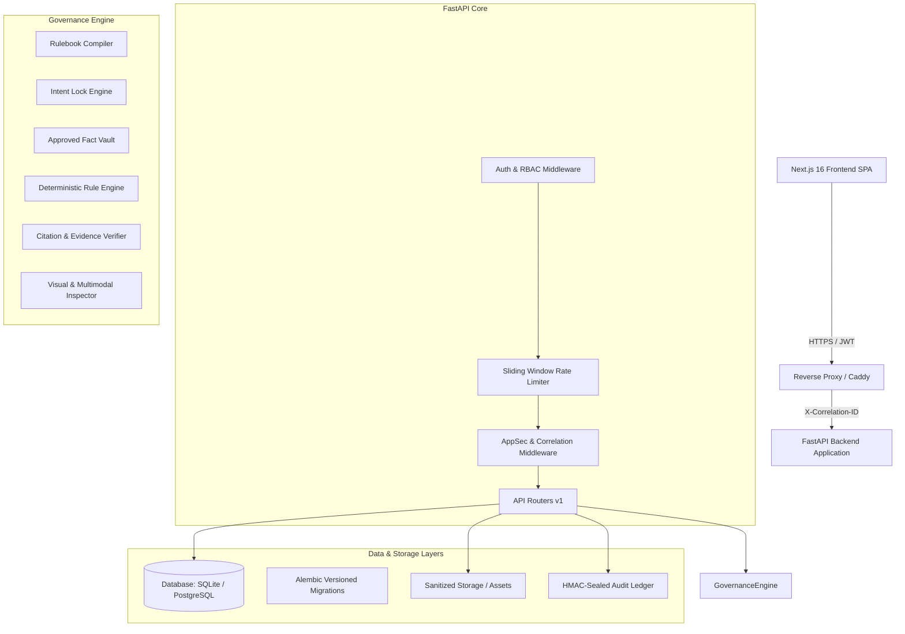

# Architecture & Engineering Specifications: CANON / FIDELIS

## 1. Executive Summary

CANON / FIDELIS is an open-source, deterministic brand governance compiler and verification platform. It compiles unstructured corporate brand guidelines into versioned, testable rules, evaluates promotional and technical content against certified evidence, enforces "No Citation, No Blocking Flag", and seals all governance actions in a cryptographically linked, tamper-evident audit ledger.

---

## 2. High-Level System Architecture

---

## 3. Component Details

### 3.1 Frontend (Next.js 16)
- **Framework**: Next.js 16 (Turbopack, React 19, TypeScript).
- **Architecture**: App router (`src/app/`) with 16 pre-rendered static routes:
  - `/login`: Secure authentication interface with persona testing indicators.
  - `/dashboard`: Unified brand governance command center.
  - `/review`: Ingestion of text, documents (PDF, DOCX), and promotional copy.
  - `/rulebook`: Rulebook compiler and test-case suite.
  - `/facts`: Certified Approved Fact Vault.
  - `/assets`: Brand asset manager (logos, typography, palettes).
  - `/approvals`: Approval decision queue with dual-custody enforcement.
  - `/audit`: Cryptographic hash chain verification and event inspection.
  - `/findings`, `/insights`, `/guide`, `/settings`.
- **Styling**: Vanilla CSS tokens (`globals.css`) with glassmorphism, responsive micro-animations, and high-contrast accessibility compliance.

### 3.2 Backend Service (FastAPI)
- **Framework**: FastAPI 0.115+, Python 3.12-3.14.
- **Middleware Pipeline**:
  1. `CORSMiddleware`: Strict origin allowlisting; wildcards prohibited with credentials in production.
  2. `RateLimitMiddleware`: Sliding window in-memory token limiter isolating Auth (20 req/min), Reviews (40 req/min), Uploads (30 req/min), and API default (150 req/min).
  3. `security_and_observability_middleware`: Injects unique `X-Correlation-ID`, `X-Content-Type-Options: nosniff`, `X-Frame-Options: DENY`, `X-XSS-Protection`, and `Strict-Transport-Security`.
- **Database Engine**: SQLAlchemy 2.0 with connection pooling, foreign keys enabled (`PRAGMA foreign_keys=ON` for SQLite), and versioned schema management via Alembic.

### 3.3 Core Governance Pipeline
1. **Rulebook Ingestion & Compilation**:
   - Parses unstructured brand guidelines into deterministic rules with structured regexes, severity tiers (`BLOCKING`, `WARNING`, `ADVISORY`), and executable pass/fail test cases.
2. **Intent Lock**:
   - Preserves promotional intent (purpose, target audience, call-to-action) so suggestions retain creator meaning while removing non-compliant phrasing.
3. **Approved Fact Vault & Claim Corroboration**:
   - Certified facts are stored with cryptographic hashes, validity horizons (`valid_until`), and certified sources.
   - Promotional assertions are verified against facts. Claims lacking approved proof are flagged (`NEEDS_PROOF` or `CONTRADICTED`).
4. **No Citation, No Blocking Flag**:
   - A finding cannot be classified as `BLOCKING` without an authoritative citation linking back to an active guideline section or certified vault fact.
5. **Dual-Custody Approvals**:
   - Creators are strictly prevented from approving their own submissions (`self_approval` blocked at API layer).
6. **Cryptographic Audit Ledger**:
   - Every state change appends an immutable block:
     $$\text{event\_hash}_n = \text{SHA256}(\text{event\_hash}_{n-1} \parallel \text{actor\_id} \parallel \text{event\_type} \parallel \text{payload\_hash} \parallel \text{timestamp})$$
   - Periodic checkpoints are sealed with HMAC-SHA256 using the master security key.

---

## 4. Trust Boundaries & Tenant Isolation

1. **Client to Server**:
   - All client input is untrusted. Tokens are parsed server-side to extract `sub`, `role`, and `workspace_id`.
   - Client requests cannot specify or switch `workspace_id` directly.
2. **Workspace Isolation**:
   - Every database query for Rulebooks, Facts, Assets, Submissions, Approvals, and Audit Events filters strictly by `User.workspace_id`.
   - Cross-tenant lookups fail closed with `404 Not Found` to prevent tenancy enumeration.
3. **File Ingestion Boundary**:
   - Files are validated by magic byte signatures before parsing (`SignatureVerifier`).
   - SVG vectors are stripped of executable scripts, foreign objects, and active handlers by `SvgSecuritySanitizer`.
   - Filenames are sanitized via `FilenameFilter` to eliminate path traversal.
